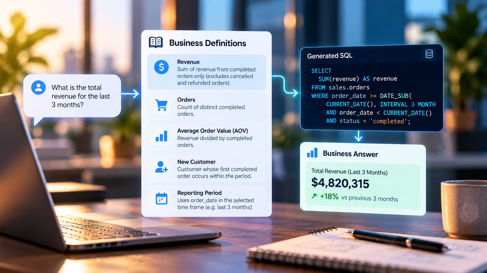

<small style="margin-bottom: -10px; display: block;">
  *An excerpt from an article written by Sree, published in 'Data Science Collective' Journal.*
  </small>
  
  
  

  **What was revenue yesterday?**
  
  
It sounds like one of the simplest analytics questions imaginable. The agent understands English. It understands SQL. It knows which database it can query. So this should be easy.

But there is a problem.

**What exactly does revenue mean?**
  
Does it mean:
  
  * Orders placed yesterday?
  * Orders invoiced yesterday?
  * Gross or net revenue?
  * Should cancelled orders be excluded?
  * Should refunds be deducted?
  * Should GST be included?
  * Which sales channels should be counted?
  
The SQL itself might be straightforward.

Understanding what the business actually means by **revenue** is the harder part. This is one of the most important lessons I learned while working with enterprise Text-to-SQL agentic systems:
  
  **An LLM can understand SQL without understanding your business.**
  
And that's why business definitions matter.

#### The Hidden Complexity Behind Simple Business Questions

Consider another question: **How many new customers did we acquire last month?**

Again, it sounds simple.

But what is a **new customer**?

Someone who:

* created an account for the first time?
* placed their first order?
* received their first invoice?
* completed their first successful transaction?
* purchased for the first time across the entire organisation?

Different definitions can produce different numbers. None of the resulting SQL queries necessarily need to be technically invalid.

In fact, every one of them could execute perfectly. The problem is that only one may match the definition used by the business.

This creates an important distinction:

**Database meaning is not the same as Business meaning**

A database tells us how information is stored. A business definition tells us how that information should be interpreted.

#### Why Schema Metadata Alone Isn't Enough

One of the first things we can give a Text-to-SQL agent is information about the database.

For example:
  
**Table:** `sales`

**Column:** `invoice_date`

**Type:** `DATE`

**Column:** `revenue`

**Type:** `NUMERIC`

That's useful. The agent now understands the structure of the data.

But consider a definition like:

Revenue is recognised against invoice date and includes only completed invoiced transactions. Cancelled orders are excluded.

That's a very different type of information. It isn't simply database metadata. It's **business knowledge**.

And without it, the model is effectively being asked to guess.

#### From Data Dictionary to Business Glossary

This is why I find it useful to separate two concepts.

#### Data Dictionary

Describes the data itself:
  
* Table names
* Column names
* Data types
* Relationships
* Field descriptions

#### Business Glossary

Describes what things mean:
  
* Revenue
* Customer
* New customer
* Returning customer
* Conversion
* Active customer
* Order
* Invoice
* Profit
* Sales growth

For a governed Text-to-SQL agent, we need both.

The data dictionary helps answer: **Where is the information?**
  
The business glossary helps answer: **How should I interpret it?**

#### The Same Word Can Mean Different Things
  
Business terminology is often more ambiguous than we realise. 

Take **conversion rate**. 

A marketing team might define conversion as: Purchases / website sessions

Another team might analyse: Purchases / users

A sales funnel might calculate: Completed orders / checkout starts

All three calculations could reasonably be described as a conversion rate. So when someone asks: **What was conversion yesterday?** the model needs more than a column description.

It needs to understand which definition applies in that particular analytics domain. This is where semantic context becomes extremely important.

#### Business Definitions as Part of the Semantic Layer

In a governed Text-to-SQL system, I don't want the LLM independently deciding what important business metrics mean.

Instead, the agent should receive trusted context before generating SQL.

Conceptually:

1.**User Question**
      

2.**Understand Business Intent**
       

3.**Retrieve Relevant Business Definitions**
       

4.**Identify Approved Data & Semantic Rules**
       

5.**Generate SQL**
       

6.**Validate**

7.**Execute**

8.**Business Answer**

Suppose the user asks:

**Which category had the highest revenue growth last month?**

Before generating SQL, the agent should understand things such as:

**Revenue:** Which revenue field and transaction statuses constitute recognized revenue?

**Last month:** Complete calendar month or trailing 30 days?

**Growth:** Compared with previous month or same month last year?

**Category:** Which product hierarchy defines category?

Only then should SQL generation begin.

#### Don't Make the Prompt Carry Everything

An obvious approach is to put every business definition directly into one enormous system prompt. That can work for small prototypes.

It becomes increasingly difficult as the system grows.

Imagine maintaining definitions for:
  
* Revenue
* Profit
* Conversion
* Customers
* Products
* Inventory
* Marketing channels
* NPS
* Customer lifetime value
* Customer segments
* Acquisition
* Retention

along with hundreds of columns and business rules.

The prompt quickly becomes difficult to maintain.

A more scalable approach is to treat business definitions as a **governed knowledge layer** that the agent can retrieve when required.

The exact implementation can vary. 

The important architectural principle is: Business logic should be explicitly defined, governed and reusable - rather than left for the model to infer.

#### Domain-Specific Agents Make This Easier
  
This was also one of the reasons I preferred domain-specific Text-to-SQL assistants rather than one enormous agent covering an entire enterprise warehouse.

A **Sales Performance Agent** needs to deeply understand concepts such as:
  
* Revenue
* Orders
* Invoices
* Products
* Categories
* Inventory
* Conversion

A **Customer Experience Agent** may instead need:
  
* NPS
* Promoters
* Detractors
* Delivery lead time
* Customer feedback
* Price competitiveness

A **Marketing Insights Agent** might require:
  
* Acquisition
* Retention
* Customer segments
* Lifetime value
* Subscribers
* Marketing channels

The narrower the domain, the easier it becomes to provide clear definitions and control how they are applied.

#### What Happens When Definitions Are Missing?

This is where evaluation becomes particularly useful.

Suppose an agent repeatedly fails questions involving year-on-year revenue.

Investigation might show that:
  
* The SQL syntax is valid.
* The correct tables are being used.
* Revenue is calculated correctly.

But the agent is comparing against the **previous month** rather than the **same period last year**. The problem isn't necessarily the LLM.

Perhaps the business definition of "YoY growth" wasn't sufficiently explicit. So instead of immediately changing models or rewriting the entire prompt, we can improve the underlying definition.

For example:
  
**Before** 
  
Revenue growth = Change in revenue between two periods.

**After**
  
Year-on-year revenue growth compares recognised revenue for the requested period against the equivalent calendar period one year earlier.

Then rerun the evaluation. This creates a useful improvement loop:
  

1.**Agent Failure**
  
  
2.**Identify Semantic Gap**
  
  
3.**Improve Business Definition**
  
  
4.**Re-test**
  
  
5.**Validate Result**
  
In other words, evaluation doesn't just tell us whether the agent failed. It can tell us **what knowledge the system is missing**.

#### When the Right Answer Is a Clarifying Question

Business definitions shouldn't force the agent to make assumptions either.

Suppose someone asks: **"Which brands grew the most?"**
  
  
Grew by what?
  
    * Revenue?
  
    * Orders?
  
    * Units?
  
    * Compared with yesterday?
  
    * Last week?
  
    * Last year?
  
A poor Text-to-SQL agent might simply make assumptions and generate SQL. A governed agent should recognise that important information is missing.

Sometimes the most trustworthy answer is:
  
**"Would you like to compare brand growth by revenue, orders or units, and over which period?"**
  
  
That may feel less impressive than instantly producing a chart. But from a business perspective, it is considerably safer.

#### Business Definitions Also Improve Consistency

There's another benefit. Business definitions aren't useful only for AI.

They force organisations to explicitly document metrics that humans may already be interpreting differently.

If five analysts calculate "new customers" in five slightly different ways, adding an LLM doesn't solve the problem. It simply makes the inconsistency faster.

A governed semantic layer encourages everyone - humans and AI - to work from the same definitions.

That makes the Text-to-SQL project partly an **AI project**, but also partly a **data governance project**.

#### Model Capability Isn't the Whole Story

It can be tempting to think that improving a Text-to-SQL system means moving to a more capable language model.

Sometimes that helps. But many failures aren't caused by a model being incapable of writing SQL. They're caused by missing context.

The model may not know:
  
* Which date field the organisation considers authoritative
* How revenue is recognised
* Which transactions should be excluded
* How customer segments are defined
* Which attribution model should be used
* Which product hierarchy is authoritative

A more sophisticated model may make a more sophisticated guess. It's still a guess.

That's why I increasingly think of enterprise Text-to-SQL performance as something like:
  
  1.**Model capability**
  
  
  2.**Trusted data**
  
  
  3.**Business definitions**
  
  
  4.**Semantic context**
  
  
  5.**Guardrails**
  
  
  6.**Evaluation**
  
The LLM is an important component. But it isn't the entire system.

#### The Bigger Lesson

When I first started thinking about Text-to-SQL, the obvious technical challenge appeared to be: **How do I get an LLM to generate good SQL?**

Over time, I realised the more important question was: **How do I give the LLM enough trusted business context to generate the right answer?**

That distinction changes how these systems are designed. A good enterprise Text-to-SQL assistant shouldn't simply know how to query a database.

It should understand:
  
  **where the trusted data lives,**
  
  **what the business metrics mean,**
  
  **which rules must be followed,**
  
  and **when it doesn't have enough information to answer safely.**

Because ultimately:

**The database stores the data. The semantic layer gives it meaning. The LLM makes that meaning accessible.**

And without reliable business definitions, even perfectly generated SQL can confidently answer the wrong question.

### About the Author

Sree is a Marketing Data Scientist and seasoned writer with over a decade of experience in data science and analytics, focusing on marketing and consumer analytics. Based in Australia, Sree is passionate about simplifying complex topics for a broad audience. His articles have appeared in esteemed outlets such as Towards Data Science, Generative AI, The Startup, and AI Advanced Journals. Learn more about his journey and work on his [portfolio - his digital home](https://srees.org/).

